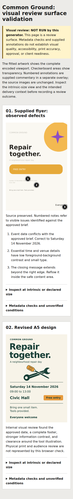

# Executed design exercises

These are fictional practice briefs used to test the skill's behavior during development. They are not real event announcements, client commissions, a human audience study, or proof that these are the only successful aesthetic choices.

| Exercise | What was tested | Inspect |
| --- | --- | --- |
| STILL / SOUND listening poster | Historical reference, three visible concepts, original vector construction, exact copy, controlled refinement, and phone-size review | [Brief, artwork, concepts, and checks](listening-poster/README.md) |
| Common Ground repair flyer | Diagnosis of an undisclosed flawed source, annotations, source preservation, correct facts, readable hierarchy, and a revised A5 master | [Before, annotated review, correction, and checks](repair-flyer/README.md) |

Agents received the task, approved content, constraints, and skill path in fresh contexts. The repair agent was not told what was wrong with the supplied flyer. The creating agents inspected renders, revised observed defects, and recorded limitations. A separate internal reviewer also inspected the selected final previews. That independent review was still AI critique, not human audience validation.

The examples include original artwork and diagnostic views. Downloaded third-party research images and font files are not included. Live-text masters need the disclosed fonts; outlined companions preserve letter shapes for viewing and transfer. Edit wording in the live-text master.

## Reproduce the review surface

From the repository root, with Pillow available:

```bash
python skills/graphic-design/scripts/review_board.py --manifest evals/examples/review-board.json --output review.html
```

Open the generated HTML locally. The [manifest](review-board.json) supplies the annotations; the generator does not diagnose the images. The generated notice correctly says the generator itself has not performed visual review.

The board was actually rendered in headless Chromium 155.0.8059.84 at 1440 and 390 CSS pixel viewport widths. Both artwork images loaded, annotation links navigated to their notes, the intrinsic-size disclosure opened, and the narrow view scrolled within its image region without page overflow. The screenshots were inspected. There were no page errors or remote page requests in this check. See [browser measurements](browser-check.json) and the [phone-width screenshot](review-board-mobile.png).



These checks cover the supplied examples in one browser. They do not certify every browser, future input, printing condition, or accessibility requirement. See the [dated validation record](../validation-2026-10-18.md) for the complete scope.
