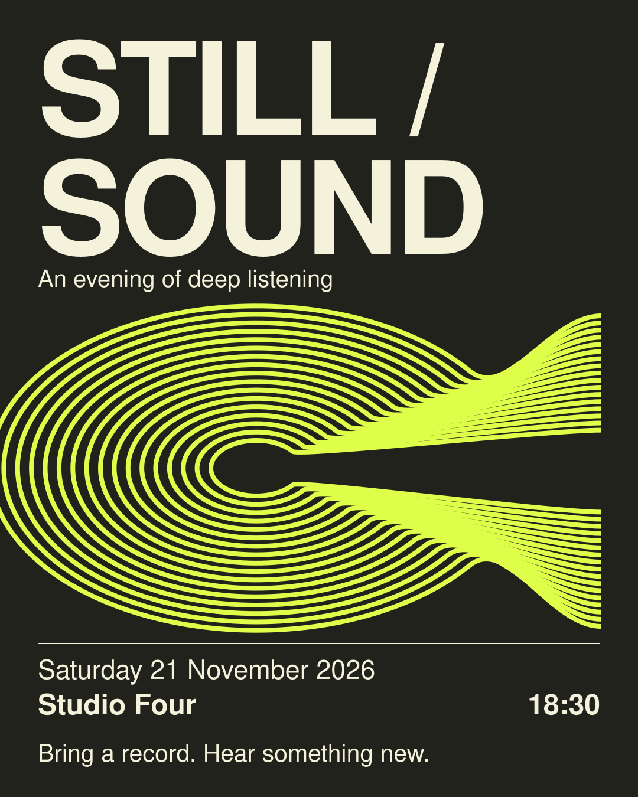
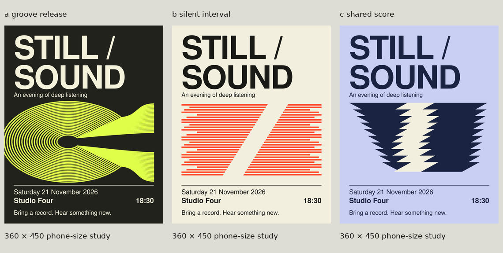

# STILL / SOUND

**Final digital artwork for a fictional evaluation brief.** See the [approved brief](brief.json).

## Concept and exploration

The selected idea turns record-like contours into two released bands, giving “Hear something new” a visual action. The open center creates a pause within the movement. Seventeen continuous paths form the illustration.

The agent compared three visible routes: an opening groove, a silent interval cut through parallel lines, and a stack of shared score-like forms. It also compared actual type specimens and refined the selected curve density and continuity. The concepts were compared using the same event content and format.

Historical research included the rhythmic abstraction of [Josef Albers's Persuasive Percussion Volume 3 sleeve, 1960](https://www.moma.org/collection/works/183801), and the spatial notation of [John Cage's Solo for Piano, 1958](https://www.moma.org/collection/works/33472). The agent inspected these references. The deliverable uses its own geometry and does not reproduce their artwork. These are accounts of reference use, not claims about measured audience response.

## Files

| File | Role |
| --- | --- |
| [Editable SVG](still-sound-editable.svg) | 1080 × 1350, named layers, live text, and editable paths |
| [Outlined SVG](still-sound-outlined.svg) | Portable lettering shapes, with wording edited in the live-text master |
| [Full PNG](still-sound.png) | 1080 × 1350, embedded sRGB profile |
| [Phone preview](still-sound-phone.png) | 360 × 450 diagnostic rendering |
| [QA measurements](qa-manifest.json) | Exact-copy, bounds, font, contrast, export, and artifact-hash records |

The live-text master uses **Nimbus Sans Regular and Bold**. No font files are included in this repository example. The QA record identifies the installed font files used for the run; it does not imply those paths exist on another computer.

## Actual review and limits

All six approved strings were checked through SVG extraction and visual reading. Dimensions, glyph coverage, text bounds, solid sRGB contrast, the full rendering, phone reduction, detail crops, grayscale, and a JPEG compression diagnostic were checked. The text/background contrast ratio is **14.2086401414:1**. The outlined version was rendered and visually compared with the live-text output; small glyph-edge rasterization differences remain, so it is not described as pixel-identical.

At phone size the tight throats become luminous bands. Individual tracks disappear in those narrow areas, while the broader contours, central opening, and essential event information remain distinguishable in the inspected rendering. The creator and a separate internal reviewer observed this behavior and accepted it as part of the selected effect.

No human audience study, actual social-platform recompression, external-editor test, physical print proof, or client approval was performed. This example demonstrates a completed design-and-review loop for one brief, not a validated universal quality level.
