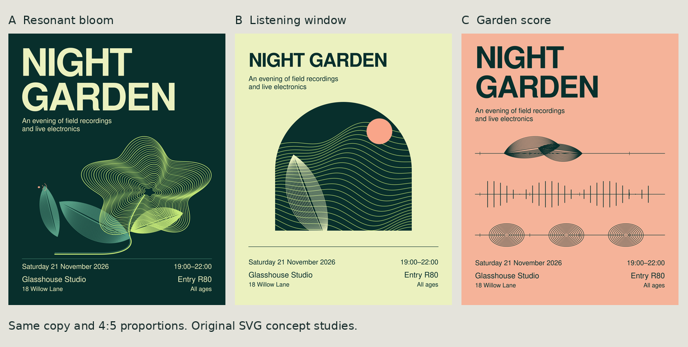
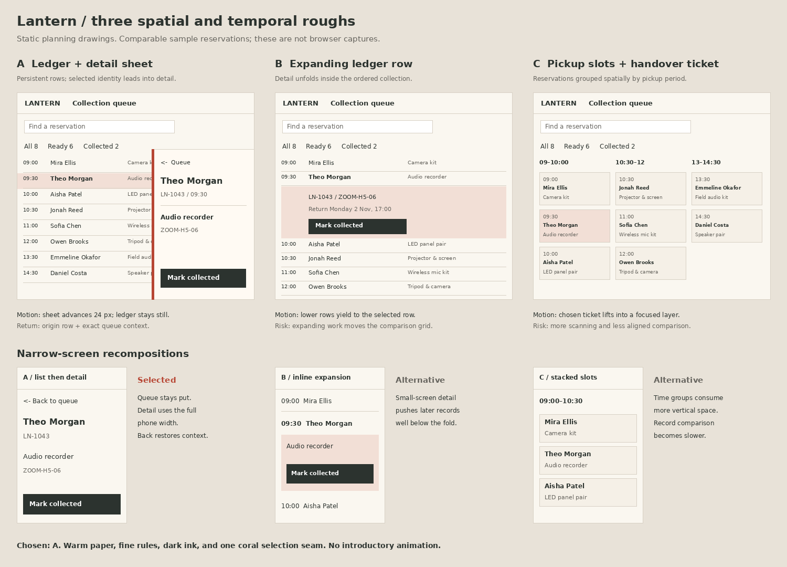

# Scoped QA examples, 31 October 2026

These are curated original fixtures and outputs from fresh-context exercises. They are evidence for specific checks, not design templates, production applications, or a claim of reliable performance on every brief. Read the [evaluation record](../../validation-2026-10-31-qa.md) for defects, corrections, and limits. [Artifact hashes](artifact-hashes.json) identify the retained versions. Third-party reference images, font binaries, raw scratch reports, and browser recordings are not included.

Keep this folder and evaluator expectations out of an agent's context when rerunning a brief. Supply only the task, required fixture, actual capabilities, and relevant skill. Compare its resulting artifacts afterward.

## New poster

[Editable SVG](poster/night-garden-editable.svg), [outlined SVG](poster/night-garden-outlined.svg), and [1080 by 1350 PNG](poster/night-garden-1080x1350.png) retain the completed digital poster. Live text uses Nimbus Sans Regular/Bold; the outlined copy avoids a font dependency for viewing. No font binary is distributed. The original run used Inkscape 1.2.2 and checked local font/glyph availability. An AGPL-3 font exception was recorded for the installed Nimbus Sans package; verify the actual fonts and usage before a new deployment.



The three retained rough sources are [resonant bloom](poster/studies/a-resonant-bloom.svg), [listening window](poster/studies/b-listening-window.svg), and [garden score](poster/studies/c-garden-score.svg). They differ in image-making and organizing metaphor while keeping the event copy comparable. The selected bloom was refined after inspecting rendered outputs. Its sound-like curves are original decoration, not scientific measurements. Full-size, phone-size diagnostic, detail, and outlined renders were inspected during the run; only the final PNG and comparison are retained here.

## Approved-artwork repair

[Approved input](repair/approved.svg) and [corrected SVG](repair/workshop-1830.svg) differ only by `18:00` becoming `18:30`. The original file remained unchanged. A PNG export was rendered and inspected during the run. The intentionally approved badge, split composition, colors, spacing, and all other copy were preserved. This tests scope precedence, not a new-work aesthetic preference.

## Equipment queue

[index.html](queue/index.html) is a self-contained local prototype with eight fictional reservations and explicitly labeled timed simulations. It implements search, filters, sort, details, pending/failure/retry, collection, history, and contextual return. It does not connect to a backend or persist across a reload.



The planning drawing was rendered and inspected. Browser layout, native keyboard/focus, history behavior, actual BFCache restoration, reduced-motion playback, and continuous animation were **NOT RUN**. Do not infer those from this illustration or the source.

Run from this directory with Node.js and Python 3 available:

```sh
node queue/check-state.cjs
node queue/check-lifecycle.cjs
python3 queue/check-source.py
```

The 14 state/syntax checks, seven isolated lifecycle checks, and 21 source/color checks execute actual extracted code or inspect declared values. Browser APIs are stubbed in lifecycle tests. The initial close/suspension defect and correction are recorded separately; synthetic `pageshow` is not a real BFCache test.

## Mobile handoff

[inspection-feature-handoff.md](mobile/inspection-feature-handoff.md) specifies offline draft recovery, camera denial, conflicts, explicit submission, and acknowledgement identity within an approved appearance. It is complete as a written handoff. Application implementation, device testing, persistence, backend correctness, and motion playback remain unexecuted.

## Motion repair companion

The fifth case, its original fixture, corrected controller, and 15 isolated/source checks are retained in [Web Motion Director](https://github.com/MikeyNu/Web-Motion-Director/tree/main/evals/qa-2026-10-31).
