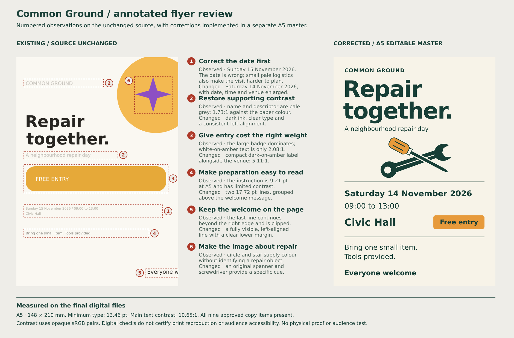
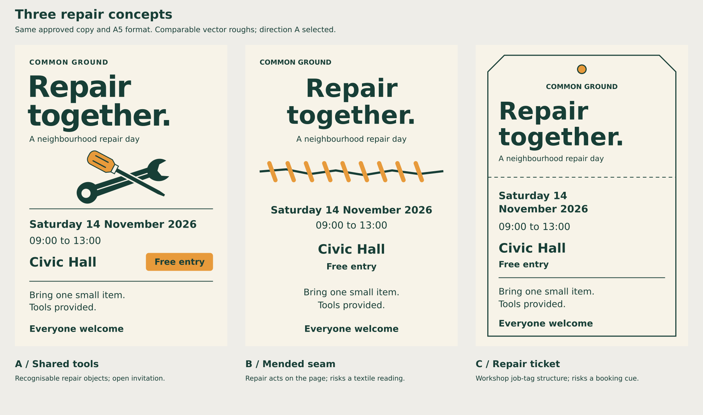

# Common Ground

**Corrected digital artwork and annotated review for a fictional A5 brief.** See the [approved brief](brief.json). The original intentionally contains defects and remains unchanged as evaluation evidence.

## What the exercise exposed

The agent identified the wrong event date without being given a diagnosis. It also found weak contrast, small logistical information, a cropped welcome message, excessive emphasis on free entry, and imagery with little connection to repair. The annotations show where the issues occur, explain their consequences, and distinguish the implemented correction from the unchanged source.

Three concepts were compared: shared tools, a mended seam, and a repair ticket. The selected original spanner and screwdriver prioritize recognizable repair activity. The agent judged distinctiveness as adequate because crossed tools are a familiar category convention. It did not pretend that a familiar subject cue was an unprecedented invention.

A first version placed the illustration too close to the descriptor and divider. The agent reduced and repositioned it, rendered again, and inspected the clearance. A separate subtraction comparison removed an extra curved workbench line because it competed with the existing information divider.

## Files

| File | Role |
| --- | --- |
| [Preserved source](source-original.svg) | Original SVG with the incorrect date and clipping intact |
| [Source preview](source-preview.png) | Rendered evidence used in the review |
| [Corrected editable SVG](common-ground-a5.svg) | 148 × 210 mm, live text, grouped objects, original tool paths |
| [Outlined SVG](common-ground-a5-outlined.svg) | Portable lettering shapes; edit wording in the live-text master |
| [Full PNG](common-ground-a5.png) | 1748 × 2480 pixel sRGB preview |
| [Smaller preview](common-ground-a5-small.png) | 592 × 840 diagnostic view |
| [Annotated review SVG](annotated-review.svg) | Editable labels and region markers with embedded before/after evidence |
| [Annotated review PNG](annotated-review.png) | 1880 × 1240 review sheet |
| [QA record](qa-report.json) | Performed checks, measurements, source preservation, and limitations |

The live-text master uses **DejaVu Sans Regular and Bold 2.37**. Font files are not included in this repository example. The outlined companion is provided for display when those fonts are unavailable.

## Actual measurements and review

All nine approved copy items are present. The correct date is **Saturday 14 November 2026**. Source preservation was checked byte-for-byte. The final SVG's dimensions, aspect ratio, references, text bounds, font resolution, and required glyphs were checked, and both live-text and outlined exports were rendered and inspected.

The master uses a 592 × 840 viewBox mapped to 148 × 210 mm. Its smallest type is **13.46 pt at A5**, calculated from that mapping rather than inferred from a chat preview. Instructions and the welcome line are **17.72 pt**. Text uses **10.6481007905:1** contrast on cream and **5.1064959418:1** on amber for the specified opaque sRGB pairs. These are digital measurements, not certification of the printed result.

The creator inspected full, reduced, grayscale, information-detail, and annotated renders. A separate internal reviewer inspected the selected correction and review sheet and found no further consequential visible defect. The annotated SVG embeds the actual source and corrected views; its image payloads were compared with the corresponding PNG files.

**Print status:** This is A5 trim-size RGB artwork. No printer dieline, stock, output profile, bleed specification, separations, overprint review, or physical proof was supplied or validated. No audience study, full accessibility audit, external-editor test, or client approval was performed. The design's welcoming tone remains a design hypothesis.
